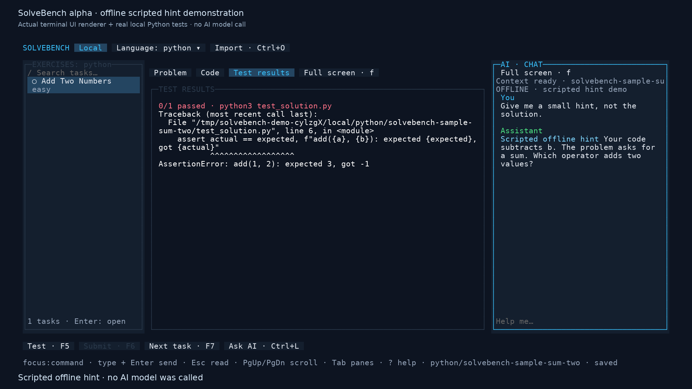

# SolveBench

Solve coding exercises in your terminal with the question, editor, test results
and an optional context-aware assistant in one window. You write the solution;
the assistant replies with text. Import your own exercise folders or use the
Exercism and LeetCode adapters.

**Linux alpha · MIT licensed · v0.1.0-alpha.1.** The Local workflow is the
release's tested entry point. Live platform account workflows, macOS and Windows
are not validated for this alpha.



[Watch the 37-second demo](docs/media/demo/solvebench-offline-demo.mp4) ·
[Animated preview](docs/media/demo/solvebench-offline-demo.gif)

The demo uses actual UI captures and real local Python test runs with a scripted
offline assistant. It is a paced sequence, not a continuous screen recording or
an evaluation of a real model. [Capture details](docs/media/demo/README.md).

## Install and try

Requires Linux, Bash, tar and **Bun 1.4.2** on PATH. The bundled sample also needs
Python 3; it needs no account, API key or third-party Python packages. Install
Bun using its [official instructions](https://bun.sh/docs/installation).

From a downloaded source tree or checkout:

```sh
bash install.sh --source "$PWD"
export PATH="$HOME/.local/bin:$PATH"
solvebench --sample
```

The installer needs network access or a populated Bun cache for dependencies.
It installs into `~/.local/share/solvebench/releases/` and creates
`~/.local/bin/solvebench`, without sudo. If PATH already includes that directory,
the export is unnecessary. The installed workspace lives separately at
`~/.local/share/solvebench/workspace/`; updates preserve it. Failed updates keep
the previous launcher. Repeat the same install command to update a checkout;
`--prefix DIR` selects a different installation root.

The selected public repository is `Blitz00X/solvebench`; publication is pending.
The installer supports a pinned GitHub tag with
`--repo Blitz00X/solvebench --version v0.1.0-alpha.1`. That download command
becomes usable after the repository and tag are published.

1. `--sample` opens **Add Two Numbers** on the Local platform.
2. Press **F5**. The starter intentionally fails.
3. Press **Ctrl+E** and change `return 0` to `return a + b`.
4. Press **F5** again: all three examples pass. **Ctrl+C** exits; unsaved
   solution changes offer save, discard or cancel.

`solvebench` reopens the managed workspace; `solvebench --sample` reopens the
sample without resetting your saved solution. `solvebench --repo /path/to/work`
uses a different workspace. `--help` and `--version` work without opening the UI.
Without a configured model, the assistant is clearly labelled **offline demo**.

For development:

```sh
bun install --frozen-lockfile
bun run dev
# From any directory, use /path/to/solvebench/bin/pairs --repo /path/to/work
```

The developer launcher uses the current directory by default. A Git repository
is not required for an exercise workspace.

### Existing PairHarness workspaces

SolveBench reads `pairharness.config.json`, the previous global configuration,
and `PAIRHARNESS_API_KEY` for compatibility. Workspace configuration precedes
global configuration; within each location the new filename takes precedence.
For the default key name, `SOLVEBENCH_API_KEY` is preferred over the previous
variable. An explicitly configured key name is used as written.
Existing `.pairharness/` progress/toolchains are reused
when `.solvebench/` is absent, and the sample shortcut preserves an older saved
sample attempt. No existing configuration or solution is moved or overwritten.
For a previously installed workspace, use `solvebench --repo /path/to/old/workspace`
to open the same exercise files. Both old and new private paths are gitignored
and excluded from source installations.

## Interface and keys

Left: searchable exercises. Center: **Problem / Code / Test results**. Right:
the assistant and its input. Markdown statements and replies have headings,
emphasis, code highlighting and tables. Both center and assistant panes offer
fullscreen reading. Small terminals have separate work and AI views.
Opening a task shows its Problem first; Ctrl+E opens the solution editor.

| Key | Action |
| --- | --- |
| Tab / Shift+Tab | Move between panes and actions |
| Arrows + Enter | Choose and activate focused items |
| / | Search tasks; Esc leaves search |
| Ctrl+T | Search/select a language |
| Ctrl+O | Import an exercise folder or collection |
| Ctrl+E | Enter/leave the solution editor |
| Ctrl+S | Save solution files |
| F5 | Save and test, from any pane |
| F6 | Save, test if needed, then submit on a remote platform |
| F7 | Open the next unlocked task |
| F8 | Cycle exercise sources |
| Ctrl+L | Focus the assistant input |
| PgUp / PgDn | Scroll the focused reading pane or chat |
| Esc | Leave an input for its reading pane; restore fullscreen |
| f | Toggle fullscreen from the center or AI reading pane |
| Enter in AI reading | Return to chat input |
| ? | Scrollable shortcut help, outside text inputs |
| Ctrl+C | Exit with a save/discard/cancel prompt for dirty solution files |

`f` and `?` remain normal text while typing. From the editor or chat input,
press Esc before `f`. Tab in the editor inserts four spaces; F5 runs from the
editor. Primary actions are clickable. Fullscreen changes preserve buffers,
chat drafts and scroll positions. Unsent chat drafts are not saved on exit;
full chat/session restoration is not implemented.

## Import custom questions

Choose **Import · Ctrl+O**, paste a folder path and press Enter. A single package
or a collection of immediate child packages works; `~/...` paths are supported.
There is no remote submission for Local exercises.

```text
my-exercises/
└── sum-two/
    ├── exercise.json
    ├── question.md
    ├── solution.py
    └── test_solution.py
```

```json
{
  "title": "Add Two Numbers",
  "language": "python",
  "difficulty": "easy",
  "statement": "question.md",
  "solutionFiles": ["solution.py"],
  "testFiles": ["test_solution.py"],
  "testCommand": ["python3", "test_solution.py"]
}
```

`title`, `language`, `solutionFiles` and `testCommand` are required. `statement`
defaults to `question.md`; `difficulty` defaults to `unknown`. Optional `slug`
sets a stable identifier, otherwise the folder name is used. `timeoutMs`
defaults to 120000, with a maximum of 600000. If `testFiles` is omitted, common
names such as `test_solution.py`, `*.test.js` and `*_test.go` are detected for
assistant context. Declared paths are relative to the package.

Imports copy into `exercises/local/<language>/<slug>/` inside the workspace.
Original folders are untouched; edits persist across restarts. Collections are
validated and staged together. Duplicate identifiers fail without overwriting
solutions. Symlinks and escaping paths are rejected; dependency/build folders
such as `.git`, `node_modules`, `.venv`, `build` and `target` are excluded.

Importing does not run code. **F5 executes the declared command with your user
permissions; this is not a sandbox.** Only run packages you trust, and install
their language tools/dependencies first. Commands use an argument array rather
than an implicit shell. Nonzero exits, missing tools and timeouts are reported
with output. Common summaries are parsed; an unrecognized successful command
counts as one passing command. Automatic `.in`/`.out` pairing is not implemented.

## Optional connections

### Exercism

An existing Exercism token or `EXERCISM_API_TOKEN` is reused when available.
Otherwise choose **Connect** and paste the token from your account's API/CLI
settings. Isolated CLI configuration is stored in `.exercism-cli/`; the existing
Exercism workspace is not reconfigured. The CLI is downloaded locally if absent.

Exercises use `exercises/<track>/<slug>`. Submission uploads your solution and
then completes the exercise on Exercism to unlock the next tasks. Upload and
completion failures are shown separately; an upload is labelled **submitted**.
These are live account actions. The alpha's Local checks do not validate them.

Supported Exercism tracks include Bash, Python, JavaScript, TypeScript, Go,
Rust, Java, C and C++. Opening a task can download managed toolchains and install
exercise dependencies under the workspace; no sudo is used. Unsupported tracks
are labelled in the picker.

### LeetCode

The adapter supports a public catalog and statements. Platform Run and Submit
need your own `LEETCODE_SESSION` and `csrftoken` through **Connect**; credentials
are masked and stored locally with mode 0600. Expiry/challenges are reported,
not bypassed. Run uses `cases.txt`; Submit waits for the platform evaluation.
Live account workflows have not been validated for this release.

### AI assistant

Set a provider in `solvebench.config.json` in the workspace, or
`~/.config/solvebench/config.json`. An OpenAI-compatible HTTP example:

```json
{
  "provider": {
    "kind": "http",
    "baseUrl": "http://localhost:11434/v1",
    "model": "your-installed-model",
    "apiKeyEnv": "SOLVEBENCH_API_KEY",
    "maxTokens": 4096
  }
}
```

Use your provider's actual endpoint/model and put any required key in the named
environment variable. Configuration and `.env` are ignored by Git. Without a
real provider, responses come from the labelled offline mock.

The configured provider receives the opened statement, current solution files,
relevant test files, latest raw test output and conversation. Avoid sending
private exercise material to a provider you do not trust. See [PRIVACY.md](PRIVACY.md)
for local storage, network behavior and deletion instructions.

An opened task is distinct from a highlighted browser row. Test results record
the solution revision: editing makes a previous passing run stale. Switching
tasks clears the previous task's chat; late replies from the old task are hidden.

## Contributing and checks

See [CONTRIBUTING.md](CONTRIBUTING.md), [SECURITY.md](SECURITY.md),
[third-party notices](THIRD_PARTY_NOTICES.md) and the [MIT license](LICENSE).
Bug/feedback templates are included. For repeatable checks, install Python 3,
pytest and bats alongside Bun, then run:

```sh
bun run typecheck
bun test
bash scripts/test-installer.sh
```

[Alpha validation](docs/ALPHA_VALIDATION.md) records exact checks and remaining
publication gates. Real terminal scripts use Python `pyte`:
`scripts/pty-local-import.py` tests import/edit/F5;
`scripts/pty-installed-sample.py` tests a fresh installed sample and safe restart.
`scripts/pty-workbench.py` additionally exercises the configured Exercism
workspace, navigation, Markdown, fullscreen and Unicode; it needs that setup.

Live verification scripts under `scripts/verify-*.ts` may contact platforms,
download toolchains or call your configured model. Review them before running.
Exercises, connections, toolchains and local memory are gitignored.
